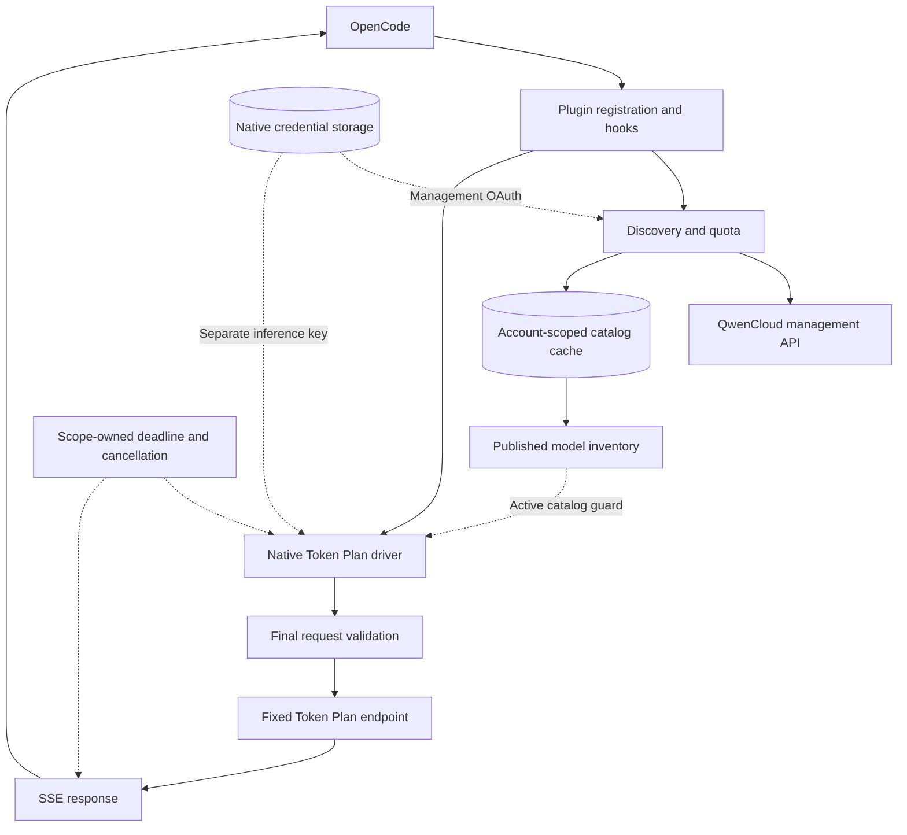
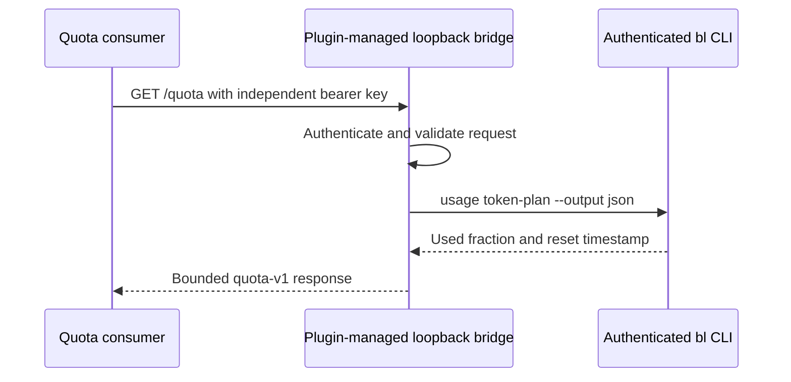

# Architecture

The package is an Effect-native OpenCode 2.2.5 plugin. It follows the official QwenCloud CLI's separation of management OAuth and inference keys; it does not reuse Qwen Code subscription auth.

## Components

- `src/index.ts`: native integrations, provider registration, RPC methods and account/catalog hooks.
- `src/oauth.ts`, `src/catalog.ts`: device authorization with PKCE, bounded management responses and model metadata validation.
- `src/discovery.ts`, `src/inventory.ts`: account-scoped catalog cache, invalidation and native model definitions.
- `src/token-plan.ts`: time-bounded, documentation-sourced Token Plan supplements, projected only over a nonempty account-bound catalog. See [Token Plan discovery](docs/token-plan.md).
- `src/pricing.ts`: bounded catalog tariffs and conservative native token-cost projection, including the explicitly approved missing-cache estimate. See [pricing semantics](docs/pricing.md).
- `src/driver.ts`, `src/transport.ts`: Token Plan chat driver, final request validation and stream-lifetime cancellation.
- `src/quota.ts`, `src/quota-cli.ts`: validated quota observations, independent console CLI reads and the separate management/BSS reader.
- `src/quota-bridge.ts`, `src/quota-bridge-plugin.ts`, `src/quota-bridge-state.ts`: optional authenticated loopback transport, shared plugin-scoped leases and ephemeral-key ownership. The standalone `src/quota-adapter.ts` remains available for legacy setups.

## Credentials and storage

OpenCode owns both credential records: `qwencloud-oauth` for management and `qwencloud-api-key` for inference. The plugin never imports the CLI's private login files or provisions keys. A key's format or presence does not establish its owner or entitlement.

Plugin storage contains a device-client UUID and sanitized catalog metadata, not credentials. Cache records are partitioned by management connection and routing, with denial tombstones preventing revoked metadata from returning after reload. OAuth expiry requires signing in again; there is no supported refresh-token endpoint.

The optional plugin-managed bridge has an independent bearer key. With explicit `autoKey` configuration it supplies a generated key through the server process environment for the unchanged quota consumer; other trusted plugins in the same process can access that environment. Adding `shared: true` persists a bridge-only key in owner-private state and enables authenticated listener discovery and automatic ownership takeover across processes. The versioned process-wide registry still manages local location leases. Disposal removes only owned, matching environment values, while shared mode retains the private state key. Immutable shared workspace records preserve executable discovery fences across hosts. Keys are never sent to CLI subprocesses. The standalone adapter instead uses its own private key file and native RPC discovery. See [quota setup](docs/quota.md).

## Request flows

1. **Login:** `oauth.ts` talks to `https://t.qwencloud.com`, validates the browser/callback destinations, polls with PKCE and returns credentials to OpenCode. Disposing the authorization scope cancels polling.
2. **Management:** explicit catalog and `managementQuota` reads use `https://cli.qwencloud.com/data/v2/api.json`. Account changes discard in-flight results; authorization denials invalidate cached models. Catalog/status reads restore metadata without upstream calls. RPC exposes `catalog`, `status`, `refresh`, `quota` and `managementQuota` under `qwencloud`; `quota` reads the independently authenticated `bl` CLI instead of management OAuth.
3. **Chat:** the provider resolves only the separate native key. Its source connection is fenced to that key, while the HTTP hook verifies the selected model against the active account-bound inventory. That inventory includes separately labeled documentation supplements only while their validity window is open; raw account observations remain distinct. Neither check claims that the key belongs to the management account or that advertised support proves inference entitlement.
4. **Dispatch:** `driver.ts` wraps the native route with an operation-scoped `FetchHttpClient.Fetch`. After host HTTP-hook conversion, `prepareRequest` pins POST `/chat/completions`, validates the body model, replaces upstream headers and refuses redirects. The registered driver uses only `https://token-plan.maas.qwencloudapi.com/compatible-mode/v1`; the isolated PAYG helper is not a fallback. The `auto` model rejects the documented unsupported `tool_choice` and `thinking_budget` fields instead of silently dropping them.
5. **Lifetime:** a scope-owned controller/timer, retained requests and explicit response-reader cancellation enforce the deadline before headers and throughout SSE, even under garbage collection. Completion or interruption clears the timer and listeners. Do not replace this with a fetch-only timeout or global fetch patch.

`timeoutMs` accepts 1,000–600,000 milliseconds, default 600,000. The deadline covers both upstream waiting and streamed reasoning/output; the longer default avoids cutting off reasoning responses at two minutes. Explicit configuration overrides the default. A separate internal `qwencloudTimeoutMs` survives the host's removal of native transport settings before provider-module construction. Optional `quotaBridge` configuration accepts `port`, `apiKeyEnv`, `autoKey` and `shared`; shared mode requires `autoKey`. Absent or false leaves the listener disabled.

## Quota boundaries

BSS routing follows `QuerySubscriptionGray`: seat summary/addon or legacy personal/team/addon reads. Credits remain distinct from raw tokens, spending limits and Junie credits. Missing values, failures and partial results must not become zero or “not subscribed.” Team aggregate balances are not individual allocations; expiration is not a reset. Details and bounds are in [quota semantics](docs/quota.md).

The optional bridge binds IPv4 loopback, authenticates before quota access, rejects browser origins/duplicate authorization and bounds connections, payloads and request time. Explicit configuration ties it to plugin scopes; loading the plugin without that configuration starts no listener. The CLI account remains unverified against the management and inference accounts, and percentages do not imply absolute credits or model entitlement.

## Verification

Tests use synthetic credentials, mocked management responses and real loopback sockets. Driver coverage includes the lossy host conversion, fragmented SSE/tools/reasoning/usage, zero-request redirect sinks, socket closure before/during streaming, forced GC and compiled file-URL loading with separate AI/Effect copies. Catalog tests cover switching accounts, durable denials and storage failures; quota/adapter tests cover partial observations and hostile requests.

Local tests do not establish upstream entitlement. The recorded native checks reached the provider but returned purchase/quota errors, not successful generations. See [protocol provenance](docs/protocol-provenance.md) for dated evidence and official sources.
